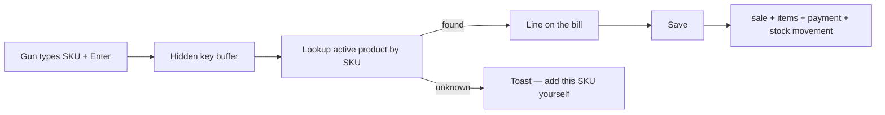
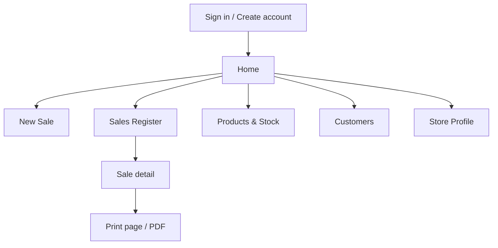

# Makhzan

**Your Inventory Under Control**

Makhzan is a local shop counter: scan barcodes, sell with cash memos and bills, track stock and dues, and print receipts in the shop's currency.

It is software for **one store on one computer**. You add your own products, take a cash memo or a bill, and keep stock and customer dues in a SQLite database that lives in this browser. It is not a CRM, not a cloud POS, and it does not look up unknown barcodes on the internet.

`React` · `Vite` · `TypeScript` · `Tailwind` · `sql.js` · local SQLite in the browser

## How a scan becomes a line



The gun is a keyboard wedge. Rapid keys under 50 ms are treated as a scan (`src/hooks/useBarcodeScanner.ts`). The New Sale page matches that code against **active** products you created (`sku` is the barcode). If nothing matches, Makhzan does not search a catalog online — it offers to open Products with that SKU filled in.

## App shell



| Route | Screen |
| --- | --- |
| `/signin`, `/signup` | Email + password. The Google button is visible; it does **not** sign you in. |
| `/` | Home — today's sales, collected, outstanding dues, low stock |
| `/sale` | New Sale — cash memo or bill |
| `/sales` | Sales Register — filter and CSV export |
| `/sales/:id` | Sale detail — remaining payment, PDF |
| `/sales/:id/print` | Printable receipt |
| `/products` | Products & stock |
| `/customers` | Walk-in and credit buyers on this computer |
| `/store` | Shop name, currency, download/import `makhzan.db` |

<details>
<summary>How to run</summary>

No cloud account, no `.env`, no API keys.

```bash
npm install
npm run dev
```

Open the URL Vite prints (usually `http://localhost:5173`). Create an account, set the shop name under **Store Profile**, add products, then take a sale.

```bash
npm run build
```

Typecheck plus production bundle. Currency rounding helpers can be checked with `npm run test:currency`.

Data stays in **this browser** (IndexedDB database `makhzan`, store `sqlite`). Another browser, another profile, or a cleared site — empty shop. Download and import `makhzan.db` from Store Profile if you want a file copy.

</details>

<details>
<summary>How a sale is saved</summary>

`createSale` in `src/db/rpc.ts` runs one SQLite transaction, then `persistDb()` writes the whole database back to IndexedDB.

1. Next document number: `CM-00001` or `BILL-00001` (`doc_sequences`).
2. Insert the `sales` header (subtotal, discount, tax, grand total, amount paid, status).
3. Insert each `sale_items` row.
4. For catalog lines, subtract `products.stock_qty` and insert a `stock_movements` row with reason `sale`.
5. If anything was paid, insert `sale_payments`.
6. `COMMIT`, then persist.

**Cash memo** is always fully paid (amount paid = grand total). **Bill** needs a customer name and may be unpaid, partial, or paid. Payment methods are cash, UPI, card, bank, cheque, or other.

Totals on the New Sale screen use the same helpers as the save path (`computeSaleTotals` in `src/lib/money.ts`):

- **Subtotal** — qty × unit price per line, integer minor units
- **Discount** — cannot exceed subtotal
- **Tax** — line tax is taken, then scaled by `(subtotal − discount) / subtotal` (proportional after discount)
- **Grand total** — subtotal − discount + tax
- **Due** — grand total − amount paid (bills)

There is no parked bill, no sale-return document, and no thermal-printer driver. Print is the browser print page plus a PDF download (`src/lib/pdf.ts`).

</details>

<details>
<summary>How barcode scanning works</summary>

`useBarcodeScanner` listens on `keydown` in the capture phase:

- Keys less than 50 ms apart are treated as a gun. Those characters are swallowed so they do not land in qty/rate boxes.
- Enter ends the scan if the buffer is at least 3 characters.
- Slow typing in an input, textarea, or select is left alone so you can still type a quantity.
- Function keys, digits bound as shortcuts, and Enter used as a gun terminator are coordinated so a barcode gun is not stolen by F-keys. Digit keys and Enter are **not** bound as shortcuts.

On New Sale, a hit calls `addProduct`. A miss toasts `No product for barcode …` with a link to add that SKU. Shop owners type their own catalog. SKU uniqueness is per user (`products_user_sku_unique` in `src/db/schema.sql`).

</details>

<details>
<summary>How money and currencies work</summary>

One **ISO currency per shop**, default **INR**, chosen in Store Profile. After the first sale, the code is locked — amounts are not converted (`updateStoreProfile` in `src/db/repo.ts`).

Catalog in `src/lib/money.ts`:

| Decimals | Codes |
| --- | --- |
| 2 | INR, AED, SAR, QAR, EGP, ILS, TRY, LBP, SYP, YER, IRR |
| 3 | KWD, BHD, OMR, JOD, IQD |

Every money column is an **integer minor unit** (paise, fils, …). Display uses `Intl.NumberFormat('en')` with that currency's fraction digits. Words on PDFs/print come from `src/lib/amountInWords.ts` (INR uses lakh/crore; others use thousand/million).

There is no FX rate table and no multi-currency on one bill.

</details>

<details>
<summary>Keyboard shortcuts</summary>

From `src/lib/shortcuts.ts` (F1 opens this same list in the app). Digits and Enter are never bound, so a barcode gun still works.

| Keys | Action |
| --- | --- |
| F1 | Open the shortcut list |
| Alt+1 | Home |
| Alt+2 | New Sale |
| Alt+3 | Sales Register |
| Alt+4 | Products & Stock |
| Alt+5 | Customers |
| Alt+6 | Store Profile |
| F2 | New Sale — focus product search |
| F4 | New Sale — toggle Cash memo / Bill |
| F6 | New Sale — focus discount |
| F7 | New Sale — focus amount paid (Bill) |
| F8 | New Sale — save · Sale — focus payment if due |
| Ctrl+Enter | New Sale — save |
| F9 | New Sale — save and print |
| F10 | New Sale — clear the bill |
| Esc | Close a dialog, or return to the scanner |
| F3 | Sales Register / Products / Customers — focus search |
| Alt+E | Sales Register — export CSV |
| Ctrl+P | Sale — print |
| Ctrl+N | Products — add product, focus SKU · Customers — add customer, focus name |

</details>

<details>
<summary>What is stored locally</summary>

SQLite tables in `src/db/schema.sql`, loaded by sql.js WASM (`src/db/engine.ts`):

- `users` / `sessions` — email, PBKDF2 hash + salt, session token
- `store_profiles` — shop name, address, GSTIN, memo footer, currency
- `products` — SKU, name, price, tax rate, stock, low-stock alert
- `customers` — name, phone, email, address, GSTIN
- `sales`, `sale_items`, `sale_payments` — memos, bills, dues
- `stock_movements` — opening, sale, adjustment, purchase, return-as-stock-in
- `doc_sequences` — CM- and BILL- numbers

The session token is also in `localStorage` under `makhzan.session`. Rows are scoped by `user_id`. Clearing site data wipes the shop. Two browsers do not share a ledger.

**This build does not** sync to another PC, talk to a server, or park an unfinished bill.

</details>

<details>
<summary>Accounts, Google button, and security notes that are true</summary>

Sign-in is **email + password** only (`src/db/auth.ts`, `src/db/crypto.ts`). Passwords are hashed with **PBKDF2** (Web Crypto, SHA-256, 120 000 iterations, random salt). The “Continue with Google” control is on the form so the layout matches a typical counter login; clicking it only toasts *Google sign-in is not available in this local shop build.* There is no OAuth client, no Google token, and no cloud user table.

Other facts that match the code:

- One browser database. Nothing is posted to a backend.
- `products.stock_qty` changes only through `createSale` or `adjustStock` (`src/db/rpc.ts`). Editing a product's name or price does not rewrite stock.
- `deleteProduct` is refused when the product appears on a sale — deactivate it instead.
- Foreign keys are on. Sale lines `REFERENCES products(id) ON DELETE RESTRICT`.

</details>

<details>
<summary>Project layout</summary>

```
makhzan/
├── index.html
├── package.json
├── vite.config.ts
├── tailwind.config.js
├── src/
│   ├── main.tsx              # boot, providers
│   ├── App.tsx               # routes
│   ├── pages/                # screens listed above
│   ├── components/           # Layout, AuthShell, ui, dialogs
│   ├── context/              # Auth, SQLite, toasts
│   ├── db/
│   │   ├── schema.sql        # tables
│   │   ├── engine.ts         # sql.js + IndexedDB
│   │   ├── rpc.ts            # createSale, payments, adjustStock
│   │   ├── repo.ts           # products, customers, profile
│   │   ├── auth.ts           # local users
│   │   └── crypto.ts         # PBKDF2
│   ├── hooks/
│   │   ├── useBarcodeScanner.ts
│   │   └── useShortcuts.ts
│   └── lib/
│       ├── money.ts          # minor units, currencies, totals
│       ├── amountInWords.ts
│       ├── shortcuts.ts
│       ├── pdf.ts
│       └── types.ts
└── scripts/assert-currency.ts
```

</details>
